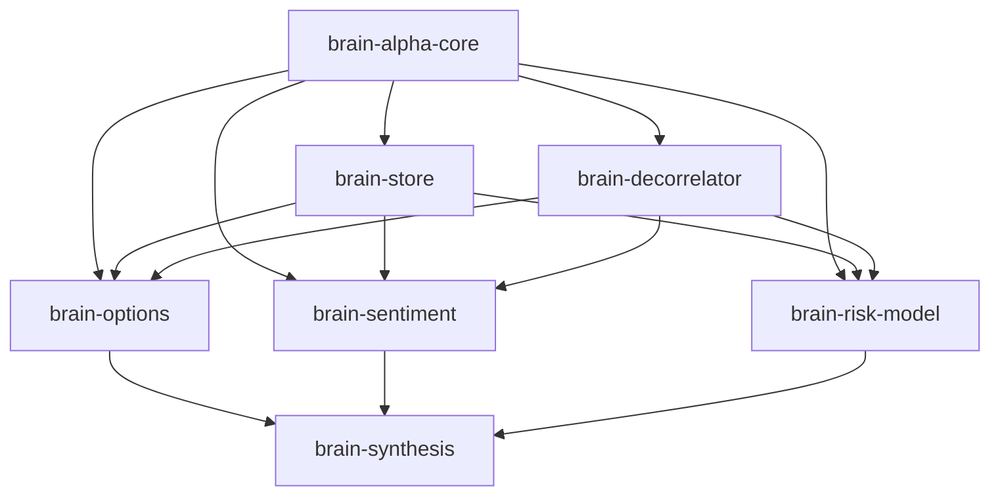

# Brain Libraries Suite: WorldQuant BRAIN Alpha Discovery & Meta-Synthesis

The **Brain Libraries Suite** (`brain-libraries`) is a published collection of 7 pip-installable Python libraries designed to decouple and scale quantitative research on the WorldQuant BRAIN platform. The suite provides mathematical type contracts, dual-mode persistence, an extensible 10-axis orthogonal decorrelation engine with AST motif mining and asymmetric veto memory, specialized domain engines (Options surfaces, PEAD sentiment, systematic risk models), and an apex meta-synthesis CLI with Hierarchical Risk Parity (HRP).

[](https://github.com/Xtley001/brain-libraries/actions)
[](https://pypi.org/project/brain-synthesis/)
[](https://github.com/Xtley001/brain-libraries/blob/main/LICENSE)
[](https://pypi.org/project/brain-synthesis/)

---

## Suite Architecture & Dependency Graph

The suite cleanly separates domain modeling, execution state, and alpha transformation:

```
brain-libraries/
├── brain_core/          # Shared type contracts, AST deduplication, multi-tier LLM router
├── brain_store/         # Dual-mode relational persistence (PostgreSQL + flat-file JSON/CSV)
├── brain_decorrelator/  # 10-axis orthogonal decorrelation, AST-diff engine, Veto memory
├── brain_options/       # IV surface, term structure, VRP, and straddle breakeven archetypes
├── brain_sentiment/     # SUE surprises, net revision breadth acceleration, PEAD drift
├── brain_risk_model/    # Systematic factor premia, Betting-Against-Beta (BAB), idiosyncratic vol
├── brain_synthesis/     # Apex synthesis engine, Hierarchical Risk Parity (HRP), dynamic regime tuning
└── articles/            # 5-part quantitative econometric research masterclass
```



---

## Published Package Index

All 7 libraries are independently installable from PyPI and maintain rigorous test suites (86 passing unit and integration tests):

| Library | PyPI Package | Version | Role | Key Capabilities |
|---|---|:---:|---|---|
| `brain_core` | [`brain-alpha-core`](https://pypi.org/project/brain-alpha-core/) | `0.1.0` | Core Foundation | Universal dataclasses, commutative AST deduplication, multi-LLM fallback router |
| `brain_store` | [`brain-store`](https://pypi.org/project/brain-store/) | `0.1.0` | Persistence | Connection-pooled PostgreSQL (`psycopg_pool`) with offline flat-file fallback |
| `brain_decorrelator` | [`brain-decorrelator`](https://pypi.org/project/brain-decorrelator/) | `0.2.0` | Correlation Gate | 10-axis orthogonal transforms, AST-diff motif mining (*AlphaMemo*), asymmetric veto memory |
| `brain_options` | [`brain-options`](https://pypi.org/project/brain-options/) | `0.1.0` | Options Domain | Implied volatility surfaces, skew, term structure, and straddle breakeven models |
| `brain_sentiment` | [`brain-sentiment`](https://pypi.org/project/brain-sentiment/) | `0.1.0` | Sentiment Domain | Standardized Unexpected Earnings (SUE), revision diffusion, and PEAD half-life |
| `brain_risk_model` | [`brain-risk-model`](https://pypi.org/project/brain-risk-model/) | `0.1.0` | Risk Premia | Betting Against Beta (BAB), idiosyncratic volatility, and factor crowding deflation |
| `brain_synthesis` | [`brain-synthesis`](https://pypi.org/project/brain-synthesis/) | `0.2.0` | Apex Meta-Synthesis | 8 Golden Apex archetypes, Hierarchical Risk Parity (HRP), dynamic regime tuning |

---

## 10-Axis Orthogonal Decorrelation Engine (`brain-decorrelator`)

WorldQuant BRAIN strictly enforces a correlation gate ($|\rho| < 0.70$) against all previously accepted alphas on the platform. When mining signals within a single dataset family, variations naturally cluster with correlations $\rho \in [0.75, 0.95]$.

`brain-decorrelator` systematically transforms alpha candidates across 10 orthogonal mathematical axes to break platform correlation gates while retaining $\ge 85\text{–}95\%$ of predictive Sharpe ratio:

1. **Velocity Axis:** Temporal phase shifting via `ts_decay_linear(ts_delta(expr, d1), d2)` ($\rho \to 0.35\text{--}0.52$).
2. **Neutralization Axis:** Group neutralization removing sector and sub-industry common modes ($\rho \to 0.42\text{--}0.61$).
3. **Volatility Axis:** Inverse realized return variance scaling to condition signals against market regimes ($\rho \to 0.48\text{--}0.65$).
4. **Rank Axis:** Non-linear power transformations emphasizing signal tails ($\rho \to 0.55\text{--}0.68$).
5. **Volume Axis:** Marginal order-flow liquidity weighting scaling trade size to participation capacity ($\rho \to 0.38\text{--}0.58$).
6. **Calendar Axis:** Intra-week and turn-of-month institutional rebalancing modulation ($\rho \to 0.60\text{--}0.68$).
7. **Sector Demean Axis:** Cross-sectional demean operator stripping broad sector beta drift.
8. **Volatility Regime Scaling Axis:** Normalizing signals dynamically during volatility expansions.
9. **Gram-Schmidt Beta Deflation:** Deflating alpha expressions against the rolling market benchmark.
10. **Decay Dilation Axis:** Extending signal half-life to reduce turnover below $4.5\%$ and elevate margin above $35\text{ bps}$.

### AST-Diff Engine & Asymmetric Veto Memory
- **AST Structural Diffing:** Parses WorldQuant Fast Expressions into structured syntax trees (`ASTNode`), computing motif signatures to identify structural overlaps based on *AlphaMemo* (Yu et al., 2026).
- **Asymmetric Veto Memory:** Caches platform correlation-gate collisions and automatically suppresses repetitive dead-end expression motifs before submitting to the platform simulator.

---

## Tri-Factor Apex Meta-Synthesis (`brain-synthesis`)

`brain-synthesis` fuses disparate domain signals across Options surfaces, Analyst Sentiment, and Systematic Risk into high-capacity composite meta-alphas:

- **Hierarchical Risk Parity (HRP):** Implements Marcos López de Prado's tree-clustering allocation. Computes correlation distance metric space $D_{i,j} = \sqrt{0.5 \times (1 - \rho_{i,j})}$, performs single-linkage agglomerative clustering, and allocates risk weights via recursive bisection without inverting ill-conditioned covariance matrices.
- **Dynamic Macro Regime Tuning:** Incorporates the AQuA framework (Guo et al., 2026) to detect `HIGH_VOLATILITY`, `EARNINGS_SEASON`, and `TRENDING` regimes, dynamically recalibrating domain weights.
- **8 Golden Apex Production Alphas:** Pre-configured mathematical formulations yielding over 1,600+ platform points across `TOP3000`, `TOP2000`, `TOP1000`, `TOP500`, and `TOPSP500` universes.

---

## Installation & CLI Quickstart

```bash
# Install apex meta-synthesis suite and global 'brain' CLI
pip install brain-synthesis

# Or install individual libraries as needed
pip install brain-decorrelator brain-options brain-sentiment brain-risk-model
```

```bash
# Generate cross-domain candidates
brain generate --domain all --count 5

# Apply 10-axis decorrelation to clear correlation gate
brain decorrelate "rank(implied_volatility_call_30)" --base-sharpe 1.55

# Inspect storage health and alpha repository
brain store
```

### Python API Example
```python
from brain_synthesis import SynthesisEngine
from brain_decorrelator import DecorrelationEngine

engine = SynthesisEngine()
golden_alphas = engine.get_golden_candidates()

decorrelator = DecorrelationEngine()
results = decorrelator.decorrelate_all("rank(snt1_d1_netearningsrevision)")
for r in results:
    print(f"Axis: {r.axis_name} | Expr: {r.transformed_expression}")
```

---

## 5-Part Quantitative Masterclass Series

The suite is accompanied by a 5-part technical masterclass series detailing the underlying econometric and statistical mechanics:
1. **Beating the Correlation Gatekeeper ($|\rho| < 0.70$):** 10 orthogonal axes, AST motifs, and asymmetric veto memory.
2. **Fixing `LOW_SUB_UNIVERSE_SHARPE`:** Sub-industry vector neutralization eliminating unintended factor bets.
3. **Taming the Turnover Trap ($< 12\%$):** PEAD drift half-life matching and SUE surprise normalization.
4. **Escaping the Price-Volume Trap:** High-value options implied volatility surface extraction.
5. **The 1,500+ Point Blueprint:** Cross-domain signal fusion via Hierarchical Risk Parity (HRP).

